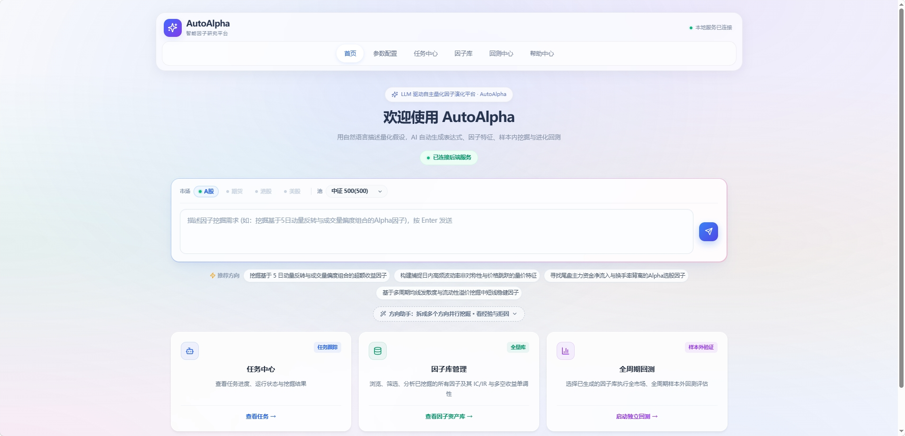
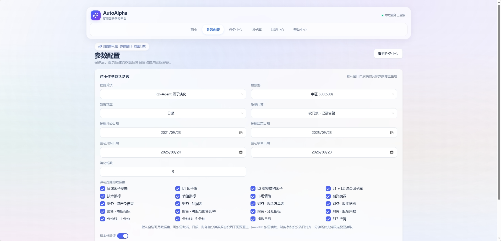
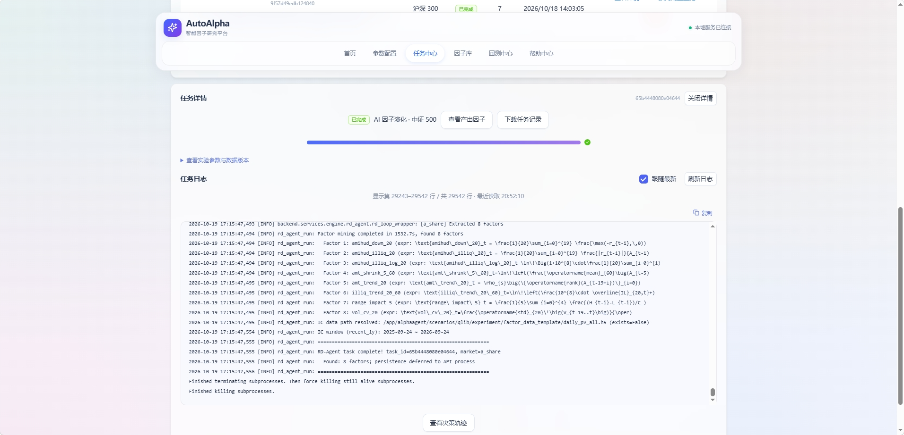
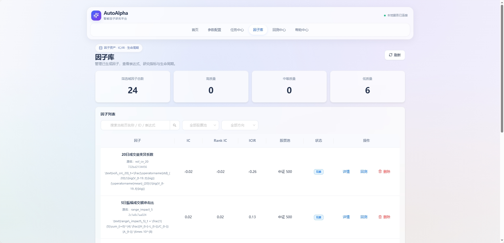
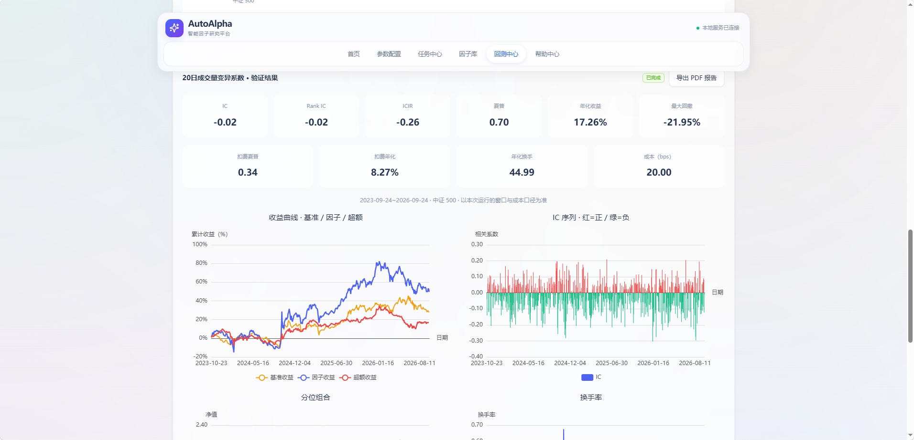

# AutoAlpha · 因子挖掘独立版

独立可运行的因子挖掘切片：统计挖掘 + RD-Agent 双引擎、因子库、回测中心、研究工作台、训练特征毕业链路。

> 来源：量化主仓 `quantmindoss@next` 的 factor-mining 切片抽取，可独立跑在 Postgres + 本地数据目录 + 独立前后端上。
> 上游是唯一的源码真相，本仓不写回上游。

## 功能

* 挖掘编排：`alpha_agent`（`statistical` / `rd_agent`）、任务租约、经验记忆、文档挖掘链
* 因子库 / 因子池 / 组合实验（前端 6 页：首页、参数配置、任务中心、因子库、回测中心、帮助中心）
* 回测中心、数据集快照报告、因子研究工作台
* Admin：挖掘因子毕业为训练特征、`rd_mined` 物化控制台
* 健康检查：`GET /health` 返回 `mounted / failed / startup / auth_disabled / startup_ddl`

## 界面预览











## 技术栈

* 后端：FastAPI，**必须 Python 3.12**（`pyqlib==0.9.7` 只有 cp38~cp312 wheel，无 sdist，3.14 不可用）
* 前端：React 18 + Vite 7 + Antd 5，9 个 runtime 依赖的瘦应用
* 存储：**必须 PostgreSQL**（用到 `pg_advisory_xact_lock`、`JSONB`、`CREATE TYPE AS ENUM`、部分唯一索引；SQLite 不可用）
* 数据：`/data/quantdb`（111GB QuantDB，只读；初始化数据下载见下文“数据准备”）、`/data/qlib/cn_data`（qlib bin，ext4）、`/data/quantcustom`

## 目录

| 路径 | 说明 |
|---|---|
| `backend/services/engine/app_factor_mining.py` | 唯一入口，只挂挖掘路由 |
| `backend/services/engine/alpha_agent/` | 挖掘编排（launcher、task_store、双引擎、factorminer） |
| `backend/services/engine/factor_{backtest,report,research,library}/` | 下游消费者 |
| `backend/services/api/routers/admin/` | 毕业 + `rd_mined` 控制台 |
| `backend/scripts/` | 离线管线（materialize → promote → validate） |
| `web/` | 瘦前端（`src/workspace/*` 为 live，`App.tsx` 硬编码 6 路由） |
| `scripts/wsl/` | 部署/运维脚本（`start-dev.sh` 等） |
| `scripts/alpha_agent/` | 挖掘 runner（`algorithms/*.yaml` 按 repo-root 相对路径解析） |
| `config/` | `runtime.env.example` 模板；`shared/auth.py` 读 `config.settings` |
| `requirements-factor-mining.txt` / `.lock` | 后端依赖 / `uv pip compile` 锁定（py3.12 x86_64） |

## 快速开始

顺序：Postgres → 后端 → 前端。

### 1. 前置

* WSL2 + Python 3.12 venv（`python -m venv --copies`，勿用 `--symlinks`）
* Node.js + `npm.cmd`（勿用 `npm.ps1`，执行策略会拦）
* PostgreSQL 18，role/db `quantmind` / `quantmind`（`scripts/wsl/pg-setup.sh`）
* 密钥 fail-closed：`export` 或写入 `~/.config/autoalpha/runtime.env`（模板见 `config/runtime.env.example`，`chmod 600`）

必填：

```bash
INTERNAL_CALL_SECRET=<随机>=32字符，且不在 auth 黑名单内>
DEEPSEEK_API_KEY / AI_IDE_LLM_API_KEY / AI_IDE_API_KEY / OPENAI_API_KEY 至少一个
SECRET_KEY=<推荐，JWT 签名；缺失则每次重启失效全部 token>
```

### 2. 数据准备（QuantDB）

初始化数据下载：https://www.modelscope.cn/datasets/qusong0627/LightGBM_Alpha300

下载后解压到 `/data/quantdb`（`scripts/wsl/link-quantdb.sh` 可建同名 symlink；上游代码在多处硬回退到该路径，只放环境变量不够）。

### 3. 后端（WSL，端口 6789）

```bash
wsl bash /mnt/d/git/autoalpha/scripts/wsl/start-dev.sh
# dev 默认：AUTH_DISABLED=1，ENABLE_STARTUP_DDL=1，仅监听 127.0.0.1
```

### 4. 前端（Windows，端口 1688）

```cmd
D:\git\autoalpha\scripts\dev-web.cmd
```

打开 http://localhost:1688 。`VITE_API_URL` 默认指向 `http://localhost:6789`。

## 验证

```powershell
# 一键：监听 + 后端健康 + PG 计数 + 前端/代理
powershell -File D:\git\autoalpha\scripts\verify-all.ps1

wsl bash /mnt/d/git/autoalpha/scripts/wsl/status.sh
wsl bash /mnt/d/git/autoalpha/scripts/wsl/run-verify.sh   # 期望 9 组 / 111 路由
wsl bash /mnt/d/git/autoalpha/scripts/wsl/pg-check.sh
wsl bash /mnt/d/git/autoalpha/scripts/wsl/quantdb-check.sh
wsl bash /mnt/d/git/autoalpha/scripts/wsl/task-lease-smoke.sh  # 一次性 PG 行，会自清理
powershell -File D:\git\autoalpha\scripts\web-smoke.ps1
powershell -File D:\git\autoalpha\scripts\no-auth-smoke.ps1

cd web; npm.cmd run typecheck; npm.cmd run build
```

只有挖掘页可用。`/api/v1/simulation/*`、`/strategies`、`/notifications` 等 404 是预期的（路由未挂载，不是 bug）。

## 认证模型（开发默认无登录）

* 后端 `AUTH_DISABLED=1` 注入 admin 身份跳过 401；前端 `VITE_DISABLE_AUTH=true` 自动登录
* `INTERNAL_CALL_SECRET + X-User-Id` 是完整认证旁路，视为**凭据**，禁提交
* `_PUBLIC_INTERNAL_DEFAULTS` 内的值（`dev-internal-call-secret`、`changeme-*` 等）一律视为未配置
* 对外暴露 6789 前：`AUTH_DISABLED=0` + 关掉 `VITE_DISABLE_AUTH` + 换真实随机 `INTERNAL_CALL_SECRET`

## 已知缺口

* 3 处函数级懒导入无目标（走对应分支才炸）：`market_analysis_hk`、`model_training`、`engine.inference`；`research.py` 路由未挂载
* `backend/scripts/` 离线管线需真实 `rd_mined` 数据，未端到端跑通过
* 无 Dockerfile/compose（此前 `engine/Dockerfile` 过期已删：py3.10 + `CMD main.py` 与实际入口不符）
* `scripts/*.ps1` 保持 ASCII-only；`web/postcss.config.cjs` 必须 `.cjs` 后缀；WSL 读不到 Windows-host 端口，反向可以

## License

AGPL-3.0（见 `pyproject.toml`）。
